# 深潮事件文本

# 事件（括号里的不要写到文案上那是给程序看的）

## 幽灵船：

遇船：

一艘庞大如黑色古堡的三桅古代帆船毫无预兆地撞破了死雾。它吃水极深，发黑的橡木侧舷挂满了石化的藤壶与海草，破烂的帆布在死寂中低垂。诡异的是，整艘船没有一盏灯火，在翻滚的涌浪里平稳得像一座死寂的礁石，连一丝颠簸都没有。

进入选项：

- 逃离：

你还留存着一丝理智，选择远离这艘诡异的船。

\(游戏继续\)

- 上船：

干渴撕碎了所有的理智与警惕，你拼命划着木筏靠了上去，抓着生锈的悬梯攀爬而上。

（下一页）

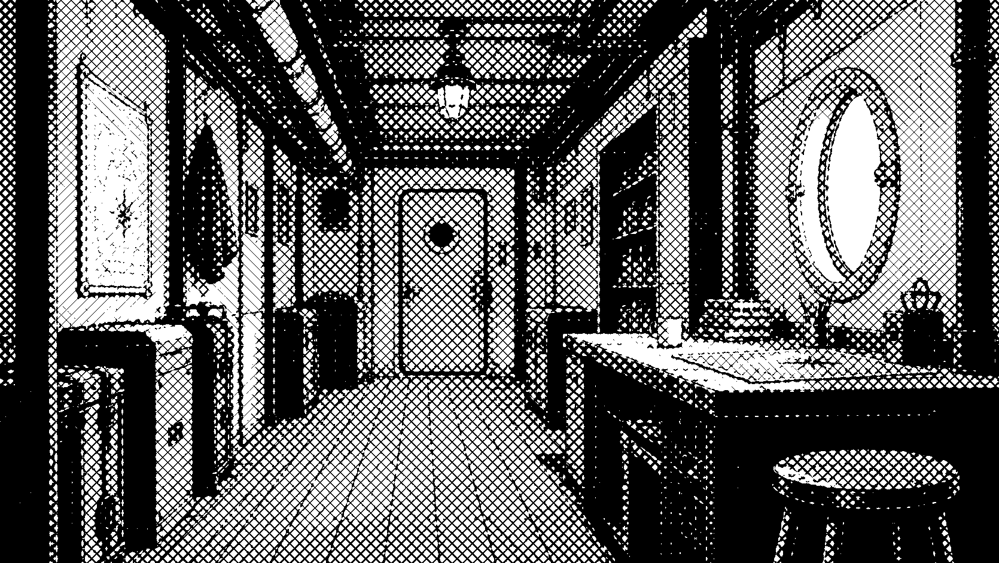

甲板上死寂无声，缆绳规整地盘在缆桩上，拖把斜靠在水桶旁，仿佛上一秒这里还有人。你撬开主货舱的铁锁，眼前堆积如山的物资让你狂喜得浑身发抖——箱子里装满厚蜡密封的干熏肉、没有变质的麦酒、干燥如新的粗麻绳，以及泛着微光的破魔余烬！你痛饮甘甜的烈酒，像疯子一样将肉干与生铁装满背囊。在这片绝望的死海上，这艘空船简直是一座凭空降临的天堂。
（san值\-10 饱食度＋50 口渴值＋50）

（下一页）

背囊沉得快要压断脊梁，本能催促你立刻带着物资返回木筏。但就在你转身时，下层幽深的走廊尽头忽然传来“咔哒”一声弹扣轻响。走廊两侧的舱门全都大开着，露出空荡荡的吊床，唯有最深处立着一扇严丝合缝闭着的门。那是一扇由惨白骨石雕凿出的门扉，表面没有把手，只有一个形似婴儿手掌的凹痕\.

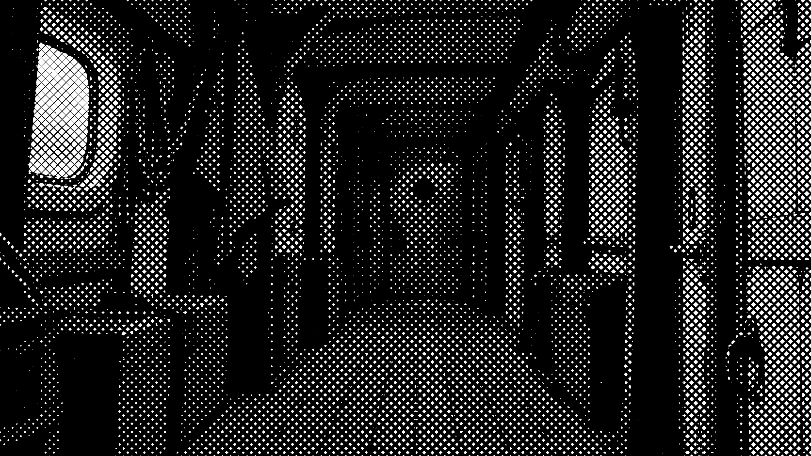

进入选项：

- 开门：

有一个声音对你说：“快进来啊”，你很想逃跑。但无形的引力却牵引着你的右手，不可抗拒地印上了那个手印。
（下一页）

骨石门扉无声滑开。门后是一片虚无的垂直断崖。在悬空的深渊中央，一颗悬浮在虚空中的灰白色巨大眼球正缓缓搏动，千万条人形白须在死寂中起伏。直视祂的瞬间，你的双眼消失了。吗？？？回归，回归回归回归回归回归回归回归回归回归回归回归回归回归回归回归回归回归。你没有死，你只是回到了你本来应该在的地方。这里是家家家家家家家家家家家家家家家家家家家家家家家家家家家家家家家家家家。
（玩家死亡，游戏进入结算页面）

- 逃走：
你已经完全僵住动不了了，当你浑身冒着冷汗全身脱力时。你才感觉身上的被注视感少了两分，随后一步一步拖着步子走了。

（san值\-15）

（结束该事件）

## 尚温的饭盒

你从冰冷的死水里捞起一只被油布裹着的铁皮饭盒。拂去上面的海盐，掀开盒盖，里面热气腾腾的鱼汤与碎麦饼竟然还在散发着微烫的余温。

- 全吃了

谁知道这饭盒从哪来的呢，虽然吃饱了，但你现在大脑一片混沌。
好香啊好香啊好香啊好香啊好香啊好香啊好香啊好香啊好香啊好香啊好香啊好香啊
还想吃还想吃还想吃还想吃还想吃还想吃还想吃还想吃还想吃还想吃还想吃还想吃还想吃还想吃
想吃想吃想吃想吃想吃想吃想吃想吃想吃想吃想吃想吃想吃想吃想吃想吃想吃想吃想吃

吃吃吃吃吃吃吃吃吃吃吃吃吃吃吃吃吃吃吃吃吃吃吃吃吃吃吃吃吃吃吃吃吃吃吃吃

（san值\-50 饱食度＋30 渴水值＋30）

- 少吃点吧

饭盒里的东西很香，你已经很久没吃过这么香的东西了，上次吃是什么时候？你头痛欲裂，不知不觉间就吃掉了饭盒里大半的东西。

（san值\-30 饱食度\+15 渴水值\+15）

- 来路不明的东西不要吃

你把饭盒扔到了一边，没多久，你发现饭盒自己消失不见了。你不由得有些害怕。
（san值\+30）

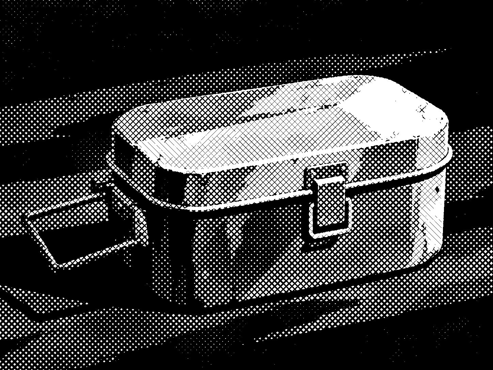

## 硬壳暗礁

你死死缩在狭窄的黑礁石缝隙里，两手捂住口鼻，连心跳都吓得快要停滞。

海面下升起的东西大得遮蔽了整个天际。那是一截如倾塌山脉般的深灰巨影，表面覆满密密麻麻开合的苍白盲眼与钙化藤壶。它甚至没有五官，只是无声地从百米外的深海里缓缓碾过。它掀起的不是浪，而是大片被自身引力撕扯悬空的静止水幕。

（san值\-20）

- 和它对战

你眼前的景物不断扭曲变形，直到它逐渐固定下来，你才发现，刚刚巨大的怪物只是一只和人差不多大的巨蟹。但很不幸，他已经盯上你了。
（进入战斗）

- 逃跑

远离他或许是个明智的选择。
（san值＋10）

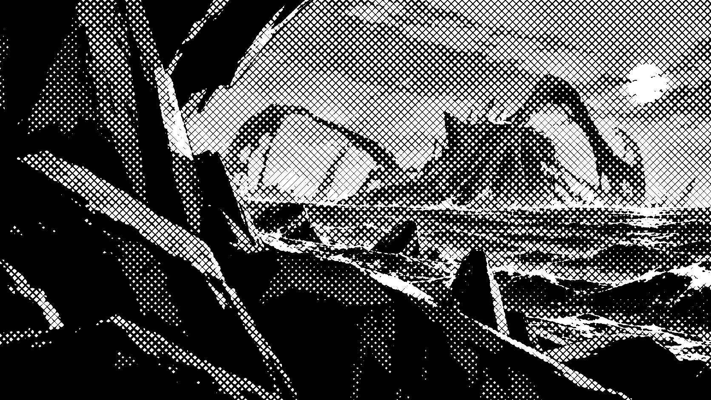

## 浮标上的便笺

三捆物资上写着“留一些给下一个人”。

- 拿走木头

（获得木头×2）

- 拿走废铁

（获得废铁×2）

- 拿走塑料

（获得塑料×2）

- 全拿走

你感觉黑暗的海水里有什么东西一直在盯着你，毕竟……贪心是有代价的。（获得木头×2 废铁×2 塑料×2 san值\-50）

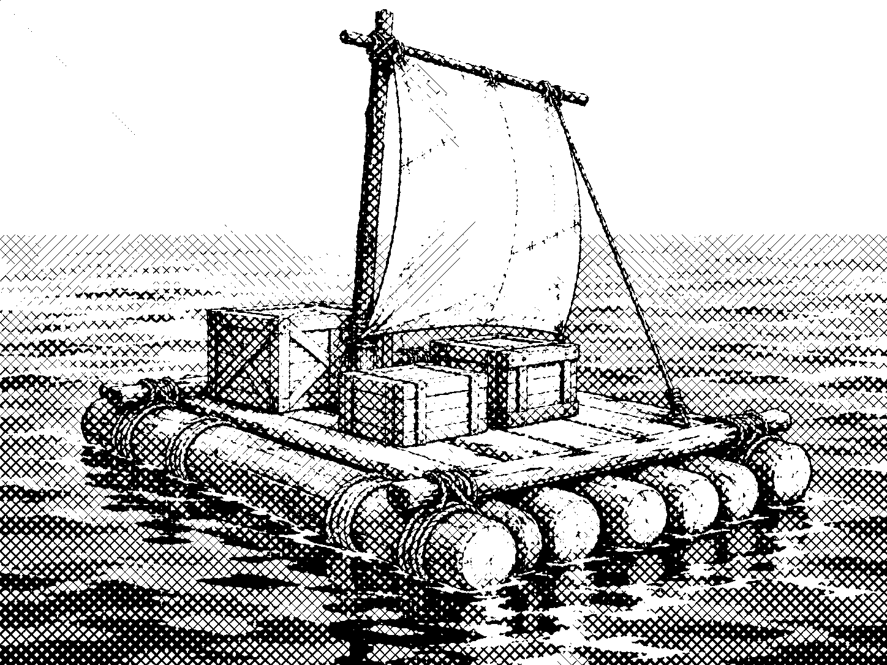

## 封蜡死箱

一口被厚重红蜡封死的深木箱漂至筏旁。箱缝渗着不祥的冷气，箱底深处，隐约传来缓慢而微弱的撞击声——“咚……咚”。

你可以只用短刀剥下外层干燥结实的防腐木条，安全离去；或者赌上一把，强行撬开箱盖。没人知道蜡层下面封着的，是上等补给，还是某个快被憋疯的活物。

- 只拆外层（获得木头×1）

- 撬箱（消耗1ap，70% 食物1\+淡水1 / 30% 废铁1 且 **HP−1（可能致死）**）

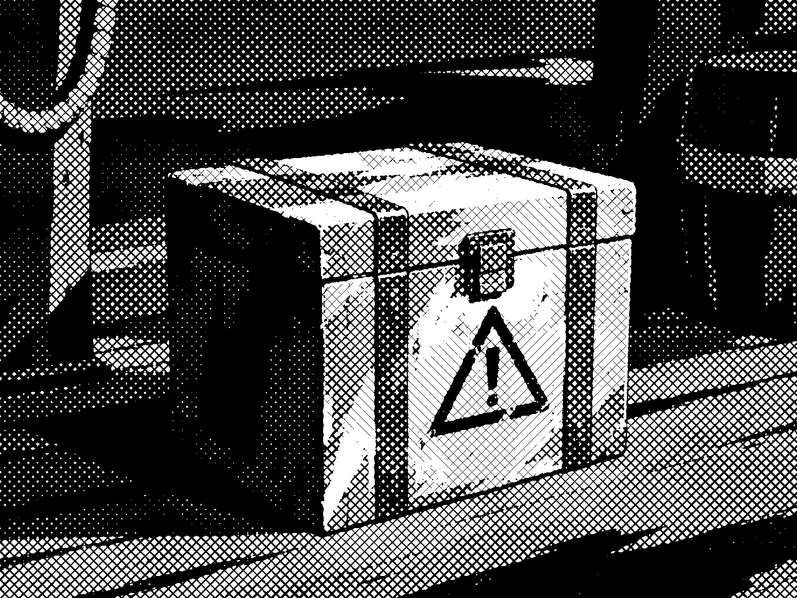

## 绳端的货箱 

一截浮木顺水撞上筏角，随手便能捞起。但你很快注意到，木料后方还拖着一根浸满死水的粗麻绳，另一端死死拴着一口半沉的密封货箱。暗流正不断把它往深水拽去，若想捞回这箱沉甸甸的未知物资，你得耗费不少体力，或者……指望那张刚装好的捕捞网帮上忙。

- 徒手拽上去（耗费2ap）\(获得随机资源牌×3\)

- 用捕捞网吧（检定有没有安装捕捞网，若无捕捞网耗费2ap，有捕捞网耗费0ap）

无捕捞网文案：你糊涂了，你根本没有捕捞网，你只能徒手把他拽上去。\(获得随机资源牌×3\)

有捕捞网文案：捕捞网真是好用啊。你根本没花什么力气就把他拽上来了。\(获得随机资源牌×3\)

## 灯火休整地

浓雾中露出一座半沉的锈蚀灯塔基座。你拼尽力气将木筏系在废弃铁桩上，爬进那处干燥的石头内舱。

厚重的石壁将外头冰冷的怪异水声死死挡住，守灯人为你提供了休整、恢复、储备的条件。在这片没有尽头的吃人死海上，这是难得能让你闭上一只眼、不用担心睡梦中被拖入深渊的方寸净土。

（此处的选项按照原事件来）

## 海怪商人

一只穿着斗篷不会说话的海怪在海上写了一块各种各样语言的牌子。上面写着“快来交易”。有些字你盯了一会就开始头晕了，不知道为什么，你心里涌起了和他交易的冲动。

（进入交易页面）

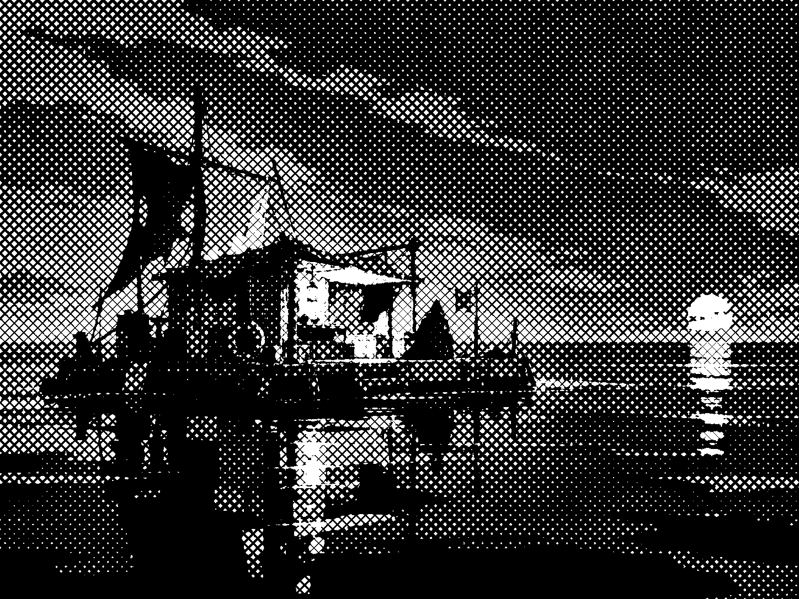

## 船底的回声

深夜的海面死寂无波，正下方的木板却突然传来了清晰的声响——“咚、咚、咚”。

三声一顿，节奏缓慢而礼貌，像是有人站在门外伸手叩门。

你屏住呼吸趴在木筏上，指甲深深掐进掌心。木板的另一侧，本该只有冰冷刺骨的海水。可那敲击声还在继续，甚至换成了指节抓挠湿木的沙沙声。水下的东西很有耐心，它在等木筏上的活人，忍不住低头往缝隙里看上一眼。

- 探索一下（50%概率饱食度＋30 50%概率san值\-30）

1. “原来是鱼。”你松了口气，又不由得窃喜起来。今天的晚饭有着落了。（饱食度＋30）

2. 你无法形容你所看到的东西，这一刻，你浑身僵住了，或许就应了那句好奇心害死猫吧。你用尽浑身力气划船，离开那里。可是你不知道那东西是否还在你的船底，午夜梦回，你恐惧的是那咚咚的声音。

- 还是别冒险了吧（san值＋10）

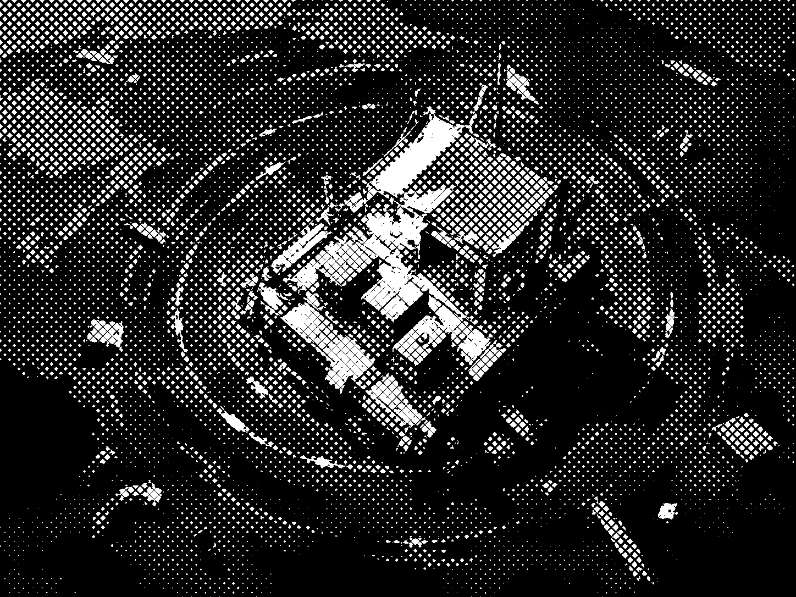

## 海面下的货舱  

一艘半倾覆的旧货船残骸倒扣在浪里。甲板早已沉入水下，唯有通气管旁卡着一只浮水货袋，伸手便可捞起。解开湿麻绳，里面完好地裹着一份应急物资。低头望去，水面下半米深处，那扇通往中层货舱的生铁舱门正虚掩着，在暗流中幽幽晃动。

- **【选项 1A】收好货袋，划桨离开**（见好就收，保留收益并结算离开）

- **【选项 1B】潜水扳开舱门（消耗 1 AP）**（推进至第二段）

你深吸一口气潜入水中，费力扳开沉重的舱门。

- **【成功·75%】**：舱内积着死水，你从破木箱里迅速摸出三件沉甸甸的完好物资！气泡翻滚间，你发现通向最深处底舱的水密盖板竟然脱落了，幽黑无光的深渊正无声吞吐着冷水。

- **【失败·25% · HP \-1】**：舱门被暗流猛然回弹狠砸在胸口，断裂的铁刺扎破皮肉（HP\-1）！呛水间你被迫蹬水浮出，舱门轰然死死闭合，无法再进。

*\(若成功：\)*

- **【选项 2A】抱紧物资，返回水面**（见好就收，带着4件资源结算离开）

- **【选项 2B】孤注一掷，潜入最底舱（消耗 1 AP）**（推进至第三段）

    

水压如重锤般压迫着肺部，你钻进了光线无法穿透的狭窄最底舱。

- **【成功·55%】**：摸索中，你的指尖撞上了一只死死卡在龙骨间的重锁箱！撬开箱盖，四份珍贵的干燥补给被你捞入怀中。你赶在窒息前猛蹬龙骨破水而出，贪婪得到了最丰厚的回报！

- **【失败·45% · HP \-2】**：摸向箱子的瞬间，沉底的重铁梁受力失衡轰然崩塌，狠狠压断你的肋骨（HP\-2）！剧痛与窒息逼得你拼死蹬开乱石逃回筏上，心有余悸地大口吐血。

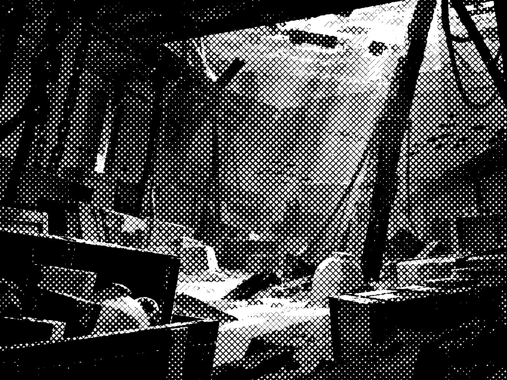

## 深潮祭坛 

“信徒啊，献上你的祭品吧，祂会回应你。”

- 流血获得食物（hp\-1 食用植物×1）

- 流血获得淡水（hp\-1 淡水×1）

- 流血获得随机材料（hp\-1 随机材料×1）

- 献祭手里的物品祈求生命（随机卡牌\-2 hp＋1）

- 直接离开

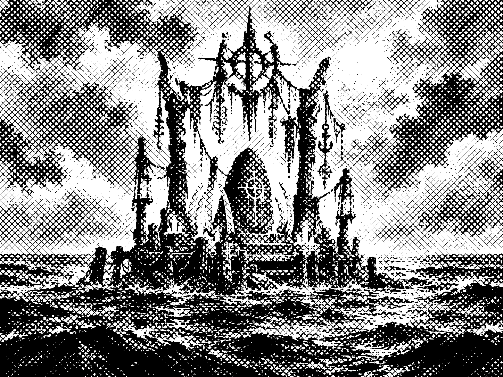

## 漂流灯塔

## 

## 捕食者水域

糟糕，你误入了他们的领地。

- 战斗

- 逃跑

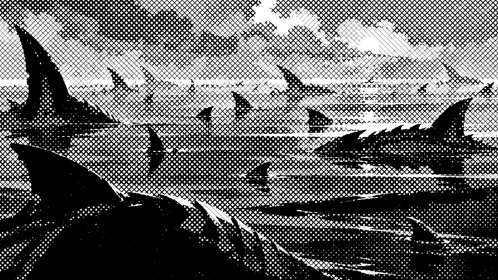

## 水母幽光

在海上，他们柔美的躯体、幽蓝的光亮，深深吸引了你的目光。不过马上他们就会告诉你，越是美丽的东西越是有毒。

- 战斗

- 逃跑

## 沉没遗迹

你误入了一片沉没的遗迹，这里本安睡着你所不知晓的事物——现在，他们醒了。

- 战斗

- 逃跑

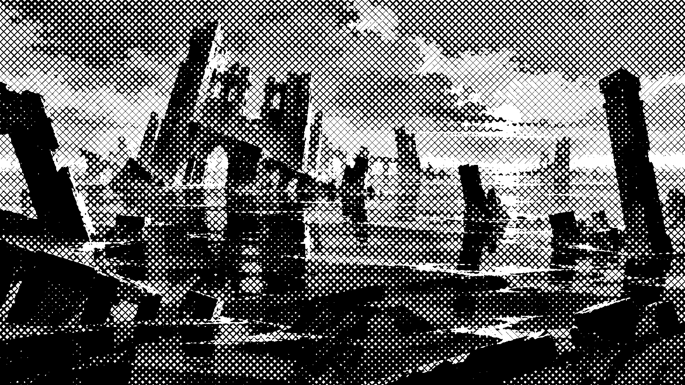

## 层底：涌潮之眼

流浪者啊，你来到这里了，有东西一直在等着你呢。

## 漂流者的午餐        

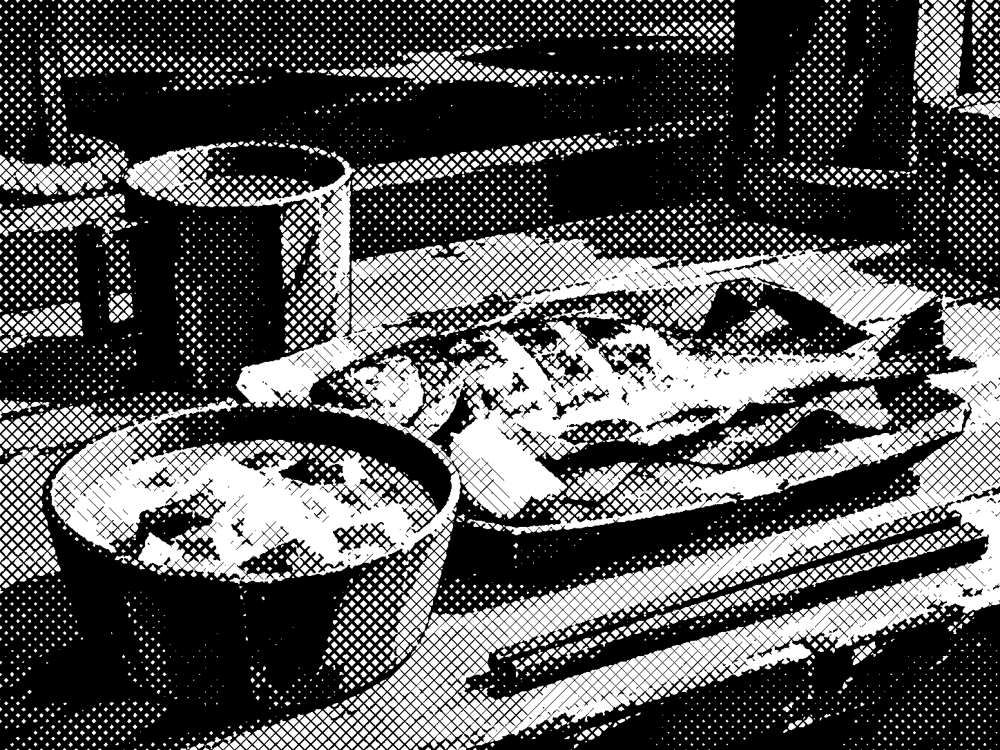

你遇上了一艘同样破烂的独木筏。筏上的流浪水手面容枯槁，却意外友善，主动将半块烤鱼递过船舷：“活着见着活人不容易，分你一口垫垫肚。”他的铁皮炉子正漏着冷风，水手看着你脚边的木板，沙哑补充道：“要是能匀两块修炉子的材料给我，我包里还有一瓶干净淡水归你。”

（饱食度＋30 san值＋10）

没问题，我帮你修（失去废铁×1 得到淡水×1）

## 筏匠的残台

一座不知哪位漂流匠人留下的半沉作业台横在浅水里。固定在木架上的旧工具还能勉强运转，旁边杂物筐里还散落着几枚没来得及带走的零件。

汹涌的涨潮正在漫上台面，时间只够你二选其一：是抓紧时间借这套工具彻底修好一格破损的木筏，还是趁被水冲走前，把筐里的实用散件搜刮一空？

- **【选项 1】争分夺秒，修好一格木筏**（修复1格受损木筏）

- **【选项 2】搜刮散件，卷走材料离开**（获得零件与基础材料包）

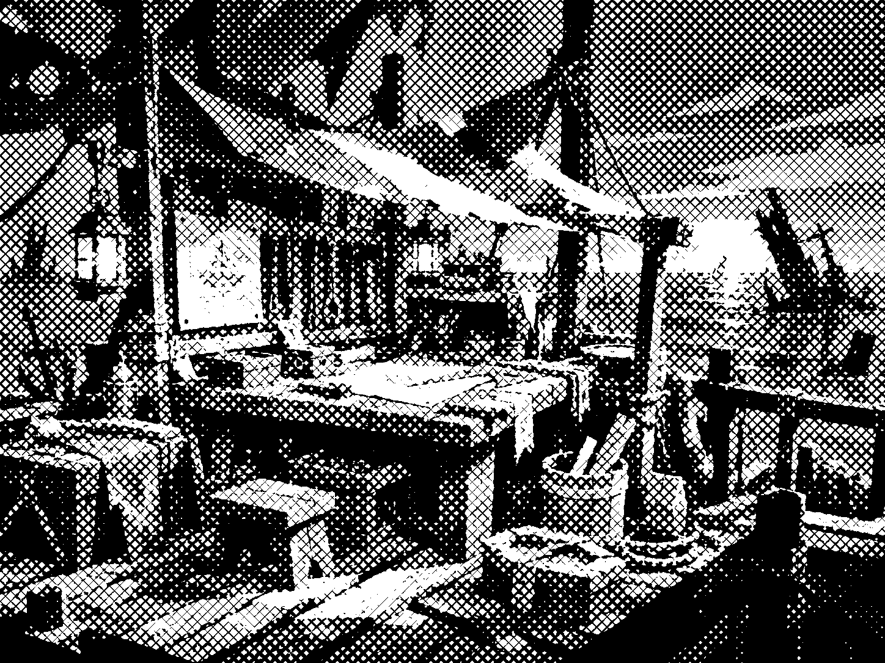

## 哨声与甲壳

前方礁石堆深处，隐隐传来受困水手的微弱金属哨音。循声望去，一头普通硬壳蟹正用螯足撕扯着浮尸；而在更阴暗的深水礁洞里，正盘踞着一头如小山般长满骨刺的重装巨蟹。

你可以顺手猎杀那头普通硬壳蟹；或是贪图更丰厚的回报，惊醒洞里那头恐怖的巨兽强敌；当然，若是状态不佳，趁它们没发现悄然绕行，也是海上活命的法子。

- **【选项 1】猎杀普通硬壳蟹**（进入普通战斗，胜者夺得战利品）

- **【选项 2】挑战深洞强敌**（挑战高危强敌，收益更丰）

- **【选项 3】掉转木筏，悄然避战**（安全离开，无奖励亦无损失）

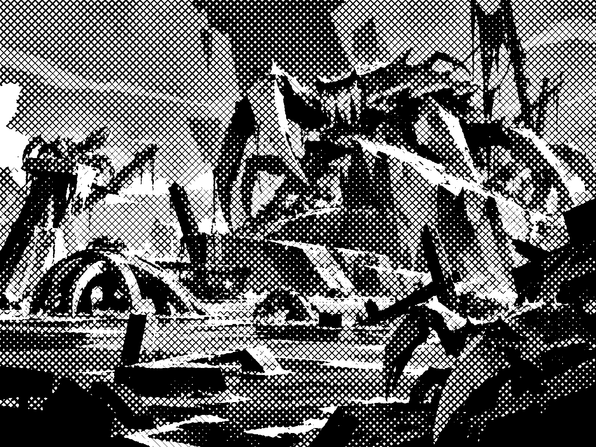

## 零星漂浮物 

今天的海面十分平静，对你来说，今天的浪潮什么也没有给你，但最起码他什么也没带走。

## 浅海守门者

你遇到了祂。想活下去，就杀了祂，过去。除此以外你别无选择。（进入战斗）

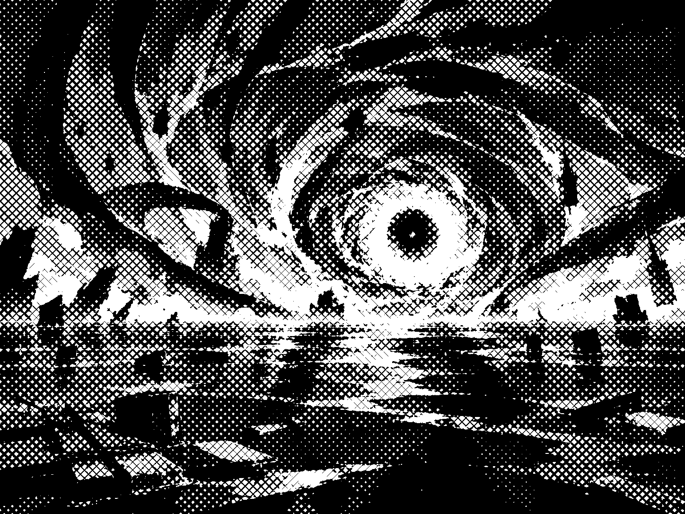

## 外海吞潮者

祂张着嘴想把你连同海水一起吞下去。而你只能用凡人之躯诅咒祂、反抗祂。呵呵，或许你并不是凡人呢？（进入战斗）

## 深渊潮心

命中注定的相遇，你的心脏和祂在共振，你隐约觉得你们流着一样的血，但今天，你们只有一个能活下来。（进入战斗）

## 密封宝箱

箱内传来物资碰撞的声音。打开可获得贝币3、食物1。

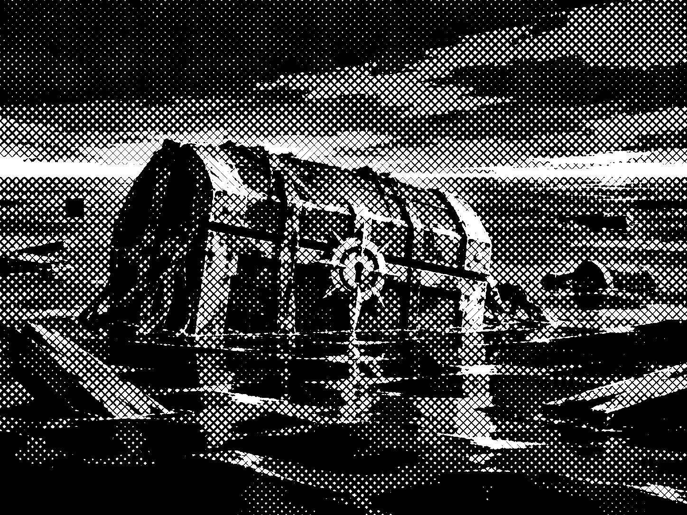

## 漂流遗物堆

为您设计了一段克苏鲁沉浸氛围的事件文案及选项设计，契合深海、狂乱与未知探索的基调：

---

### **事件：漂流遗物堆 **

一股混杂着腐烂海藻与冷冽铁锈的腥咸气息扑面而来。在黏稠黑沉的海流中，一簇庞大而畸形的残骸正缓缓沉浮。那是无数破碎的远洋船板、覆满藤壶的人骨以及不可名状之物交缠而成的聚合体。

几样泛着异样光泽的器具浮在浅层黏液之上，耳边隐隐传来如湿冷触手摩挲耳膜般的呢喃，诱惑着你伸手拾取；而在堆叠更深的黑暗网结中，似乎还缠裹着某种更沉重、更古怪的未知造物……

- **打捞浅层遗物**

这些被浅滩吐出的物件，尚在理智可承受的边缘。

- **\[分支：静潮刻碑\]** 获得遗物：静潮刻碑 *\(抚平焦躁的海浪，亦抚平躁动的心神\)*

- **\[分支：赤枝珊瑚\]** 获得遗物：赤枝珊瑚 *\(如脉搏般微微搏动，浸透着暗红的生机\)*

- **\[分支：幽光螺壳\]** 获得遗物：幽光螺壳 *\(侧耳倾听，深渊正向你吐露回音\)*

    

- **组装简易钩爪打捞深处**

用粗糙的索具探入漆黑的核心，或许能拽出被洋流遗忘的异宝。

- **（消耗**：`行动点(AP) -1`、`废铁 -1`、`绳索 -1`）

- **（收益**：获得 **随机藏品 ×1）**

    

- **移开视线并离开**

深海的馈赠往往伴随着清醒的代价。

- **（效果**：什么都不做，继续前行。）

## 旧闸口

一座巨大而阴冷的黑铁水闸横亘在咽喉要道上，宛如一头死在退潮时的史前巨兽。厚重斑驳的闸门上爬满了湿滑的苔藓与扭曲的浮雕，正中央被粗糙的防锈油漆描绘着早已模糊的禁忌符记。

闸门底下的排水槽已被黏稠的淤泥和杂物死死卡死，缝隙间正渗出暗绿色的冷光。机械的绞盘早已锈蚀，若想从那紧咬的铁齿缝隙中强行掏出卡在深处的密封暗格，你必须撬动这沉睡的旧时代造物——而它向来只认残酷的过路费。

- **选项一：以血肉强行撑开**

冰冷的齿轮刮去皮肉，温热的鲜血顺着铁锈缝隙汩汩流下。

- **（代价**：`生命值 -3`）

- **（收益**：获得 **随机藏品 ×1）**

    

- **选项二：凝视缝隙中的符咒**

- 你试图解读闸口深处那令人作呕的呢喃刻痕，某种无形之物狠狠撕扯着你的理智。

- **（代价**：`精神值(San) -8`）

- **（收益**：获得 **随机藏品 ×1）**

    

- **选项三：搭建支架物理撬动**

用木桩抵住生锈的咬合齿，以绳索借力，在机关咬合前将东西猛拽出来。

- **（代价**：`木头 -2`、`绳索 -2`）

- **（收益**：获得 **随机藏品 ×1）**

    

- **选项四：绕开这扇不祥之门**

有些门扉紧闭，本就是为了囚禁门后的东西。

- **（效果**：不付出代价，离开事件。）

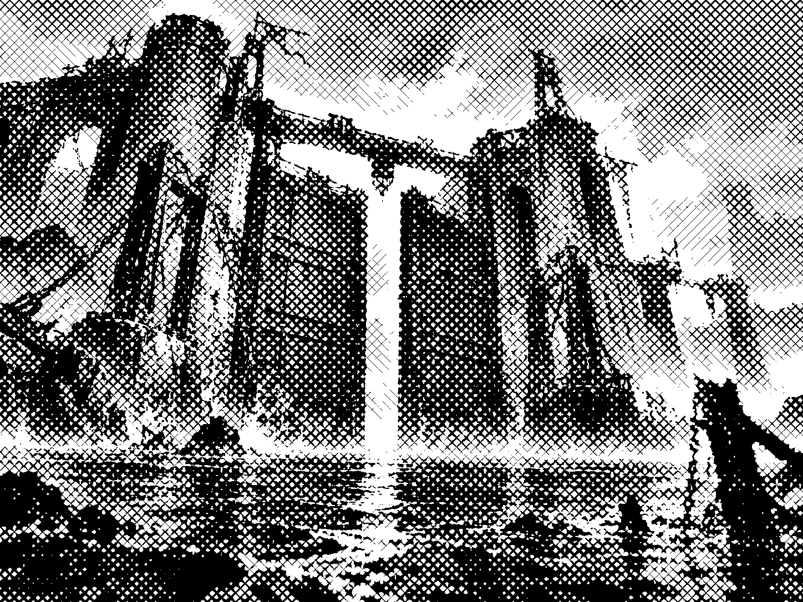

## 潮汐赌局

为您设计了\*\*「潮汐赌局」\*\*（经典“碰运气/贪婪”机制，Press Your Luck）的克系氛围文案与阶段选项系统：

---

### **事件：潮汐赌局 **

脚下的滩涂被暗红色的退潮泡沫所覆盖。在潮水急速退去的泥潭凹坑里，裸露出数只巨大如棺椁的裂口贝壳与畸形海葵。湿冷的腥风中，这些血肉活体正随着怪异的韵律一张一合，内壁隐约包裹着闪烁的金属、古老的器物以及残缺的骨殖。他们在说：“和我对赌……”

#### **【轮次选项设计】**

- 离开

- **伸进赌桌（1）**

    你将手探入微微抽搐的肉褶中，倒刺划破了皮肉，但危险尚在远处窥视。

    **（代价**：`生命值 -2`）

    

    - **选择**：

        - `[继续探摸]`（进入第2轮）

        - `[见好就收，抽手后退]`（带着已有收获离开）

            

- **伸进赌桌（2）**
**淤泥灌入了衣袖。周围泥泞下的蠕动变得愈发剧烈，似乎有什么庞然大物正被血腥味唤醒……**

    **（代价**：`生命值 -`2）

    - `[贪婪驱使，最后一次！]`（进入第3轮，极高风险）

    - `[克制贪欲，迅速离开]`（带着已有收获离开）

- **伸进赌桌（3）**

    你整条手臂没入了温热的喉管，骨骼被挤压得咔咔作响，狂乱的低语在耳髓深处炸开！

    **（代价**：`生命值-`2）

    **（结果**：结算本次收获，事件结束。）

    

---

#### **【掉落与突发事件结算文本】**

- **收获·资源**：

你的指尖从内脏般的黏液里抠出了一包干燥的残存补给。

（获得：`随机物资 (木头/绳索/废铁/食物等)`

- **收获·设备牌**：

伴随着令人牙酸的撕扯声，你扯出了一件被消化了一半的精密器械。

（获得：`随机设备牌 ×1`）

- **收获·稀有藏品**：

它的核心包裹着一块温润的旧日遗物，甚至没有被胆汁腐蚀分毫。

（获得：`随机藏品 ×1`）

- **灾难·触发战斗（探摸失败惩罚）**：

腔囊猛然收缩咬合！泥浆如沸水般翻滚，数条粗壮的触须破土而出，将你死死缠绕拖向泥潭！

**（直接进入战斗）**

