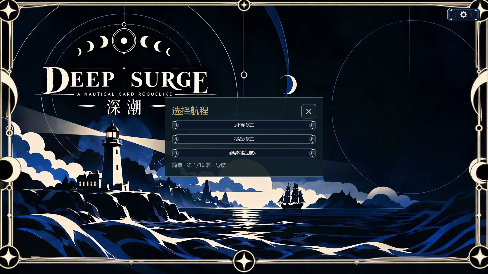
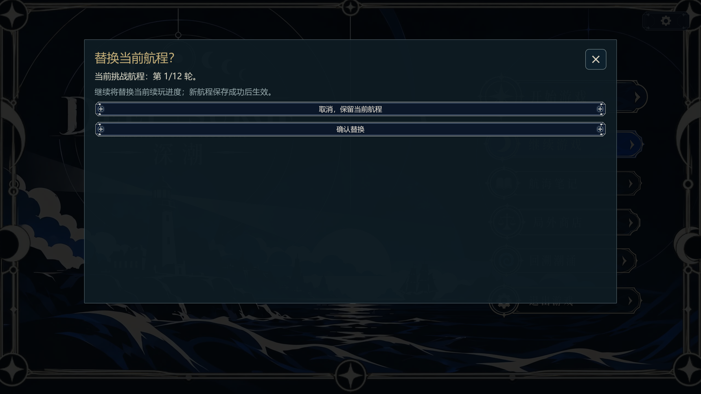
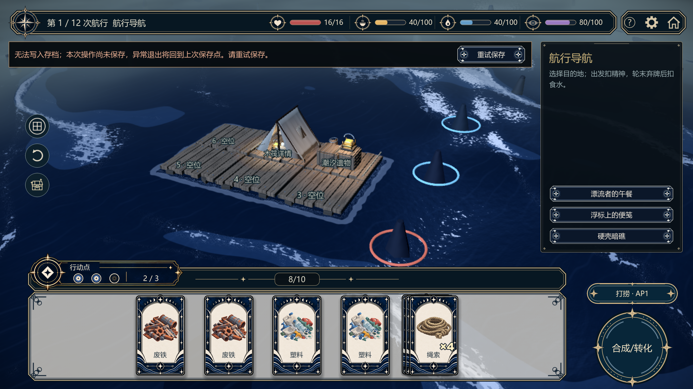

# 挑战模式异常中断恢复验证

日期：2026-10-19。Godot 4.7.2，内容 `godot-flow-v02-26`，分支 `codex/origins-v1`；验证当前未提交工作区。未提交或推送，未访问玩家真实存档。

## 实施结果

- 正式挑战的完整state与共享profile/最近结算同文件原子提交，启动保留挑战检查点并停留首页，明确选择继续才执行resume。
- 失败保留旧文件，显示待保存与重试入口，阻止继续规则变更及会话替换；查看/取消不推进随机。正常退出失败提供返回或放弃未保存操作，系统关闭请求同样处理，包括终局界面。
- 新局/剧情切换确认绑定当前revision，候选成功写盘后才发布；新剧情槽位及活动指针失败回滚。损坏、空对象、版本或指纹不符受保护，明确新建前保留原始字节副本。
- 挑战终局与积分一并保存，保存失败重启恢复旧检查点重新完成结算；终局已保存再次启动不重复奖励。独立meta失败可从有效终局补写难度解锁。

## 本次执行与证据

运行器 `tools/verify_challenge_resume.py` 为每个进程隔离 APPDATA/LOCALAPPDATA，每进程上限30秒，发现脚本错误立即失败，保存完整日志和summary。路径均相对工程根目录。

| 范围 | 实际结果 | 原始目录 |
|---|---|---|
| 最终针对性无头回归 | 14个测试进程全部通过 | `.planning/challenge-resume/20261019-202234-148625/` |
| 当前必需Agent路线 | 七条全部实际执行并通过：标准/困难/噩梦挑战与剧情、标准失败 | `.planning/challenge-resume/20261019-201600-573360/` |
| 导航/准备/事件/收尾/奖励提示/自动换轮/商店/战斗强退 | 八个检查点的真实写入进程被强杀，独立读进程逐一通过完整快照及后续命令比较 | `.planning/challenge-resume/20261019-201340-442241/`（该批末尾的终局超时不算通过，见下行） |
| 终局保存失败/保存成功后的强退 | 未保存终局强杀后重做结算积分正确，第二次重启无重复；已保存终局重启一致 | `.planning/challenge-resume/20261019-201723-877415/` |
| 非空遗物持有检查点 | 正常商店分支售卡、购买遗物后强杀；恢复遗物、完整快照及下一动作一致 | `.planning/challenge-resume/20261019-201922-631404/` |
| 真实I/O故障及拒绝数据 | `.tmp`目录阻断、非空目标目录导致替换失败、重试幂等、截断JSON、内容版本/指纹拒绝均通过 | `.planning/challenge-resume/20261019-201636-406572/` |
| 实际窗口1280×720 | 首页继续、替换确认、保存失败/重试按钮通过并截图；最终提示栏避开状态栏与操作区，已重新渲染并目视复核 | `.planning/challenge-resume/20261019-202525-246793/` |
| 文档与差异 | `check_docs.py`通过（44份入口/专题、9份当前文档、0错误）；文档检查器8项单元测试通过；按仓库原有CRLF检查差异无空白错误 | `python -m unittest discover -s tests -p test_check_docs.py -v`、`git -c core.whitespace=cr-at-eol diff --check` |

最终14项无头回归：`test_challenge_save_failure.gd`、`test_challenge_resume.gd`、`test_challenge_story_switch.gd`、`test_challenge_meta_recovery.gd`、`test_save.gd`、`test_mode_contract.gd`、`test_chapter1_saves.gd`、`test_reward_recovery.gd`、`test_narrative_repairs.gd`、`test_recall_restore.gd`、`test_application_boundaries.gd`、`test_tutorial.gd`、`test_auto_end_settings.gd`、`test_auto_progress.gd`。

新增四项无头专项分别为保存失败19项断言、续玩17项、剧情切换12项、meta恢复7项，均0失败；实际窗口专项8项断言0失败。最终规格复核和代码质量复核未发现剩余可行动问题。

meta故障回归用最小终局夹具隔离独立文件失败；真实完整路线和终局奖励强退由跨进程专项验证，不用夹具代替路线验收。UI截图测试创建游戏窗口，非无头截图。

主要复核命令：

```powershell
python tools/verify_challenge_resume.py --routes-only
python tools/verify_challenge_resume.py --skip-route-gate --faults-only
python tools/verify_challenge_resume.py --skip-route-gate --checkpoints terminal_unsaved finished
python tools/verify_challenge_resume.py --skip-route-gate --checkpoints collectible
python tools/verify_challenge_resume.py --tests test_challenge_save_failure.gd test_challenge_resume.gd test_challenge_story_switch.gd test_challenge_meta_recovery.gd test_save.gd test_mode_contract.gd test_chapter1_saves.gd test_reward_recovery.gd test_narrative_repairs.gd test_recall_restore.gd test_application_boundaries.gd test_tutorial.gd test_auto_end_settings.gd test_auto_progress.gd
python tools/verify_challenge_resume.py --gpu --tests test_challenge_save_ui.gd
python tools/check_docs.py
```

## 失败、超时与范围

- 最初新增测试在GDScript类型推断错误后超时；修正明确类型声明，并改用能立即捕获脚本错误的运行器。获得用户授权后重新执行通过。
- 原聚合七路线超过30秒而停止；获得授权后拆成七个独立进程，全部通过，不将原超时批次修改为通过。
- 原终局专项逐步重建完整UI导致超过30秒；授权后复用正式加载过渡已有的延迟渲染开关，仍逐步执行真实命令及完整保存，检查点再渲染。终局写入进程约18秒，重跑通过。用户随后明确本次可直接修正可解决的超时，长命令仍最多三次。
- 评审发现并修复：新剧情候选revision丢失、空对象存档未保护、待保存期间触发后续剧情、首页最近结算摘要缺失、终局关闭确认模态未显示。对应回归已包含在最终测试中。
- 不保证或声称已验证物理断电；未稳定注入“正在写文件/rename系统调用内部”时的强杀。当前证明成功检查点之后强杀恢复，以及实际写入/替换失败保留旧档。
- 本次实际窗口检查为桌面1280×720；未进行手机触摸、发行导出或云同步。旧版本兼容/迁移和挑战多槽位不在范围。

## 界面证据






