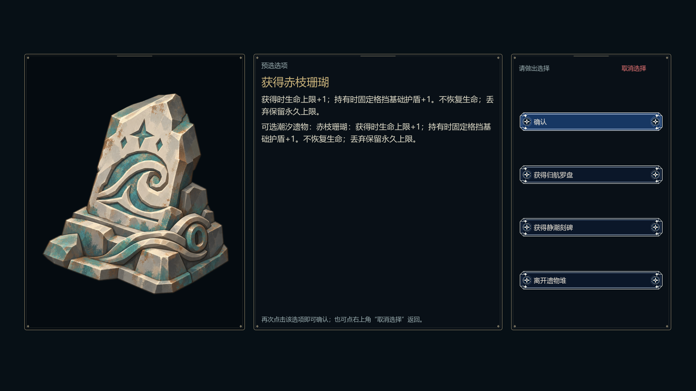
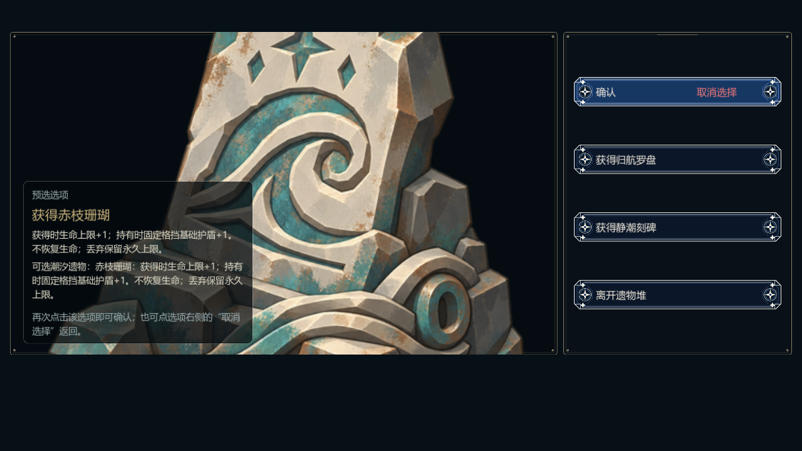

# 藏品节点、唯一性与Boss掉落验证

日期：2026-10-21；分支 `codex/integrate-v03-relics`；执行前快照 `4c30513`，内容版本 `godot-flow-v03-03`、schema2，指纹按本次内容重新生成。

## 实施范围

- 旧11个藏品相关事件保留 retired 定义，五个池替换为5类事件；每层最多1次、冷却3、起始层内站2/3/4/5/5。绞盘与吊架保持退役。
- 6件run、12件held、2件不限制；固定重复拒绝、随机空池每份2贝币；商店报价和提交遵守同一条件。
- 先完成静态A并通过独立规格/质量复核（见 batch-a-review.md），再实现揭示B。候选、揭示时池、下一获取序号、已选ID/UID和来源保存在encounter，不修改node。
- Boss各1件效果价值精选池，其他奖励保留；不新增稀有度分级。
- 全部子代理 gpt-6-luna / high；Batch B经独立规格及质量复核。旧UID收据误配问题补回归并修复；最终集成复核单独记录。

## 运行结果

| 验证 | 当次结果 |
|---|---|
| 52项相关Godot规则/集成脚本 | 全部退出0、无失败断言；见 suites-summary.json 及 final-test_*.txt |
| 揭示规则定向测试 | 82 checks，0 failures；final-test_relic_offer.txt |
| 实际GPU桌面/手机界面 | RTX4060 / OpenGL Compatibility，121 checks，退出0；final-gpu-ui.txt |
| 文档检查及Python单测 | check_docs PASS，test_check_docs.py 8 tests PASS |
| 当前必需Agent路线 | 7条重生成并分别独立重放，随后 test_routes executed=7/stale=13/failed=0；历史13条保留为stale，不代替当前执行 |
| 自然遗物堆Agent路线 | seed22从reset经合法行动自然抵达，124步揭示、125步领取；两个前缀分别独立重放通过 |

引擎命令设45秒单进程超时，Agent分段命令55秒上限，测试隔离APPDATA/LOCALAPPDATA，不访问玩家真实保存。本轮没有实际执行超时；路线按正常checkpoint继续，未将非终局前缀发布为必需终局路线。自然揭示路线专用于功能覆盖，明确为非终局前缀。

| 路线 | 步数 | 终局 | 完成节点 |
|---|---:|---|---:|
| standard-challenge | 199 | dead | 15 |
| standard-story | 167 | survived | 11 |
| hard-challenge | 373 | survived | 25 |
| hard-story | 194 | survived | 11 |
| nightmare-challenge | 86 | dead | 7 |
| nightmare-story | 174 | dead | 10 |
| standard-failure | 44 | dead | 4 |

困难挑战实际完成25站生还，其余路线结果是当前策略基线，不代表难度平衡定稿。

## 修复与边界

- 旧出身测试期待撤退扣2，核对执行分支后确认本轮前配置已为4；更新断言，未改规则。天气测试更新为退役宝箱不入池、替换遗物堆在层内第3站开放及保存恢复。
- 新揭示验证覆盖重复候选/非法ID/阶段/数量/来源/旧同ID UID伪造；领取、放弃、进入收尾、丢弃旧藏品和新领取藏品后的合法保存均可恢复，不重抽不重发。
- 早期 batch-a-* 诊断日志可能含失败；最终 final-* 与 batch-a-gate-* 为有效通过记录。部分已有保存/导航测试退出仍输出ObjectDB/资源未释放提示，未在本次扩大处理，脚本断言和退出码见原日志。
- 真实GPU只验证渲染和程序化界面操作；真实触控、发行导出和全仓所有实验脚本未运行。剧情模式保持隐藏，story路线只回归原有保留规则。
- 怪物美术、departure_notice/flow_app等同期外部改动不属于本次实现，均保留。未推送、未自动合并。

## 截图

