# 手机 21:9 全流程截图审计

类型：验证记录（布局审计）。仅对 2026-10-20 当次工作树、21:9 逻辑画布（1680×720）负责；不替换 Android 真机验收，也不改变任何规则或存档字段。

## 范围

- 在 21:9 手机比例下按真实流程依次走查 17 个界面，记录布局、被裁内容和可读性问题。
- 覆盖：首页、新局准备、航行、准备、事件（说明/选择/预选/结果）、商店（买/卖）、战斗（待机/选牌）、工具台（配方/转化）、遗物仓库、图鉴、设置。
- 不在范围：结算页、剧情模式专属画面、独立剧情文字页、Android 安全区与系统返回键。

## 执行环境

| 项 | 值 |
|---|---|
| 引擎 | Godot 4.7.2 stable，Windows，OpenGL Compatibility，RTX 4060 Laptop |
| 窗口 | 2520×1080（21:9） |
| 手机模拟 | `display_settings.mobile=true`、`ui_scale=1.25`、`free_aspect=true` |
| 逻辑画布 | 1680×720（`get_visible_rect()` 实测） |
| 夹具 | 挑战模式 standard / strong / seed 22；事件 `drift`；商店 `trader` + 120 贝币 + 1 尸体；战斗 `biter` 18HP、AP3 |

复现命令（脚本写入 `tools/`，输出目录可换）：

```powershell
Godot_v4.7.2-stable_win64_console.exe --path . --script res://tools/capture_mobile_21x9.gd `
  -- --out=res://evidence/mobile-21x9-20261020 --jpg
```

脚本按流程顺序截图并打印 `SHOT <路径> size=... logical=...`，日志里另有 `EVENT choice entries=4`（事件选项数）用于核对。

## 截图总览

| # | 界面 | 图 |
|---|---|---|
| 1 | 首页 | [01-home](mobile-21x9-20261020/01-home.jpg) |
| 2 | 新局准备 | [02-new-game](mobile-21x9-20261020/02-new-game.jpg) |
| 3 | 航行选择 | [03-navigation](mobile-21x9-20261020/03-navigation.jpg) |
| 4 | 航行准备 | [04-preparation](mobile-21x9-20261020/04-preparation.jpg) |
| 5 | 事件·说明 | [05-event-intro](mobile-21x9-20261020/05-event-intro.jpg) |
| 6 | 事件·选项（4 项） | [06-event-choice](mobile-21x9-20261020/06-event-choice.jpg) |
| 7 | 事件·预选 | [07-event-preselect](mobile-21x9-20261020/07-event-preselect.jpg) |
| 8 | 事件·结果 | [08-event-result](mobile-21x9-20261020/08-event-result.jpg) |
| 9 | 商店·买入 | [09-shop-buy](mobile-21x9-20261020/09-shop-buy.jpg) |
| 10 | 商店·出售 | [10-shop-sell](mobile-21x9-20261020/10-shop-sell.jpg) |
| 11 | 战斗·待机 | [11-battle](mobile-21x9-20261020/11-battle.jpg) |
| 12 | 战斗·选中攻击 | [12-battle-selected](mobile-21x9-20261020/12-battle-selected.jpg) |
| 13 | 工具台·配方合成 | [13-craft](mobile-21x9-20261020/13-craft.jpg) |
| 14 | 工具台·资源转化 | [14-transmute](mobile-21x9-20261020/14-transmute.jpg) |
| 15 | 潮汐遗物（仓库） | [15-warehouse](mobile-21x9-20261020/15-warehouse.jpg) |
| 16 | 图鉴（航海笔记） | [16-encyclopedia](mobile-21x9-20261020/16-encyclopedia.jpg) |
| 17 | 设置 | [17-settings](mobile-21x9-20261020/17-settings.jpg) |

## 逐屏观察

### 首页

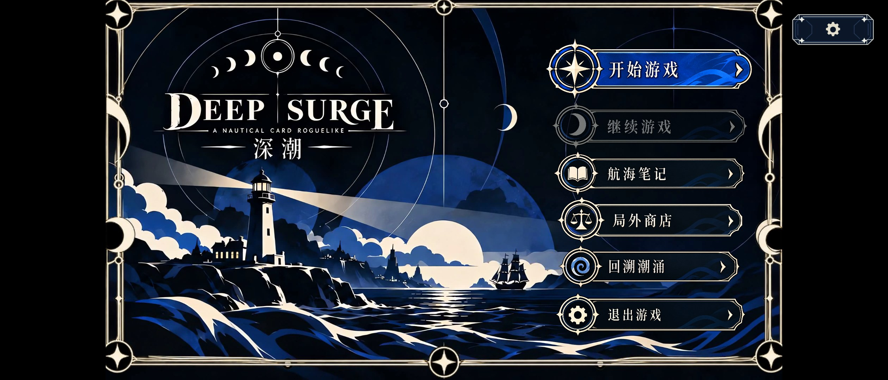

标题海报按 16:9 居中显示，左右各留 300 px 纯黑（各占 11.9% 宽度）。菜单栏、右上角设置按钮位置正常。原因在 `presentation/title_menu.gd`：`REFERENCE` 构图 + `STRETCH_KEEP_ASPECT_CENTERED` + 黑色底填充。

### 新局准备

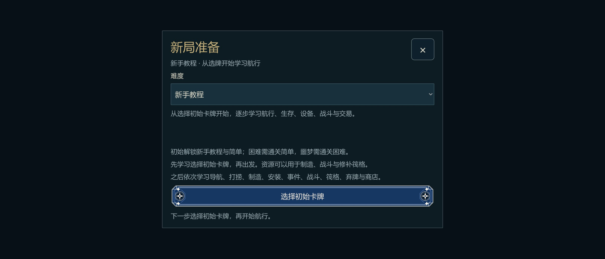

仍是桌面形态的窄弹窗：约 700 逻辑宽，只占屏宽 47%，上下左右都是空黑；右上关闭按钮也还是桌面尺寸。难度下拉、说明文字、起手入口都在一列里，21:9 的横向空间完全没用上。

### 航行选择 / 航行准备

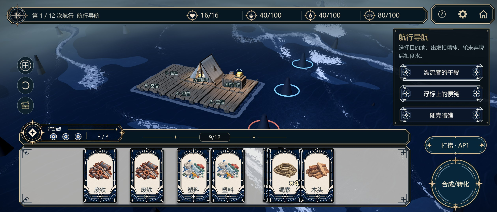

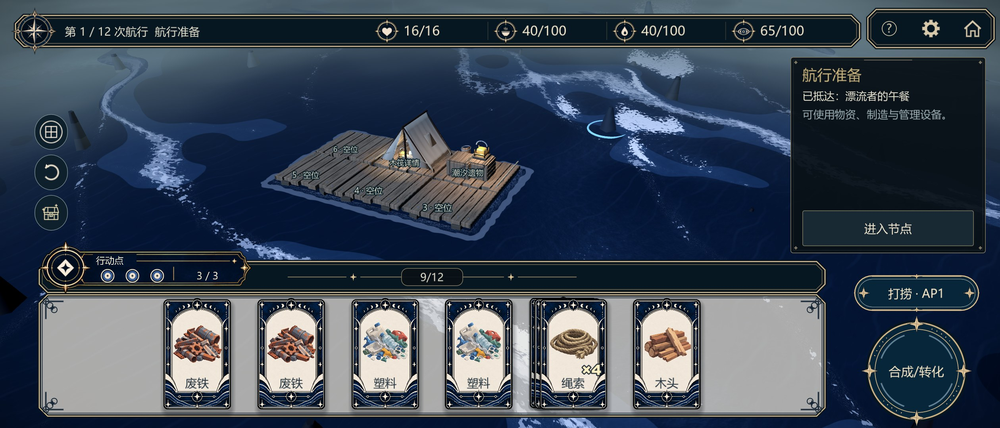

顶栏、左侧圆钮、右侧操作栏、手牌区四块结构稳定；3D 海域在 21:9 下留白明显（木筏偏小、上下空海多）。手牌托盘是一条固定 64～1388 逻辑宽的浅灰板，6～9 张时两侧仍留出大片空板。

### 事件页

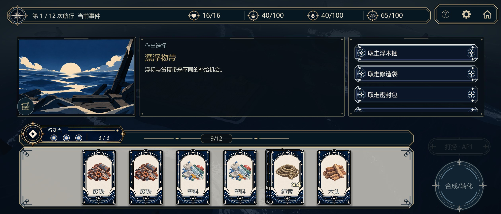

三栏比例（插画 400 / 正文 688 / 选项 456）在 21:9 下协调，插画已按 `scenes.json` 裁掉黑边铺满。**但选项栏有 4 个选项时，第 4 项「继续航行」只露出约 20 逻辑像素，且没有任何滚动提示**——`drift`、`sharedMeal`、`salvage`、`provision`、`fogGuide`、`cargo`、`camp` 共 7 个节点是 4 选项。

说明页与结果页的落位正常，正文、提示与行动按钮都没有被手牌区遮挡：

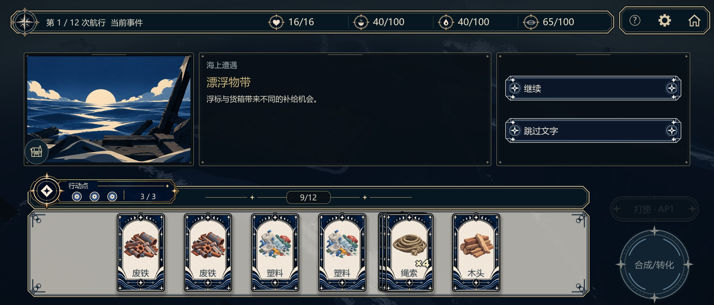

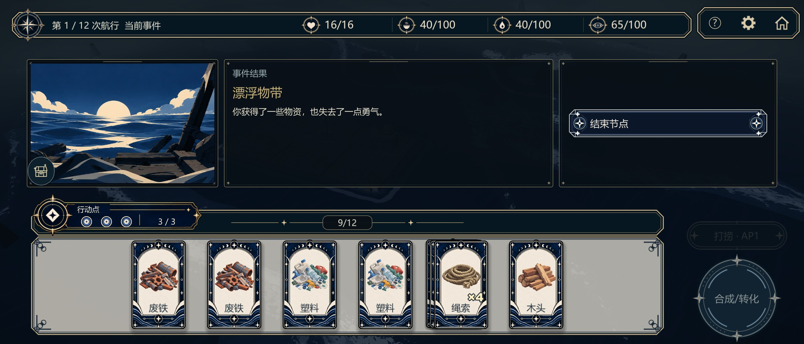

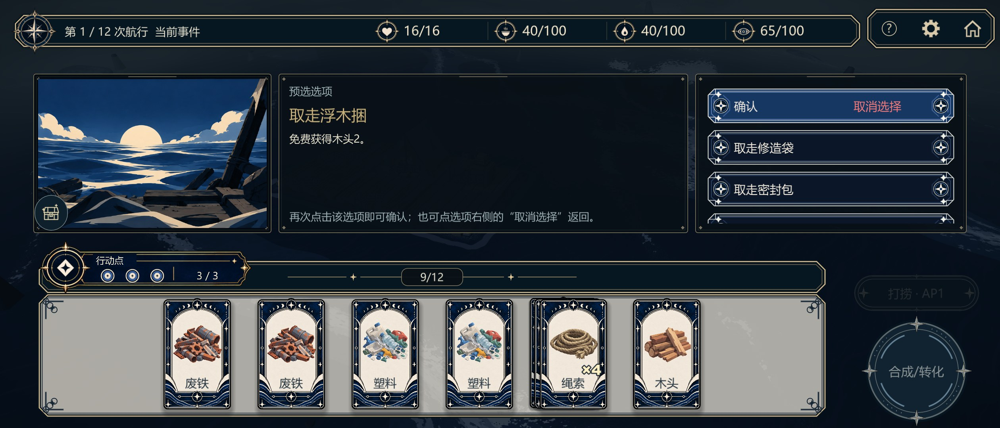

预选态正常：选项文字变「确认」，右端出现红字「取消选择」，正文栏换成选项说明，底部提示与触点一致。

### 商店

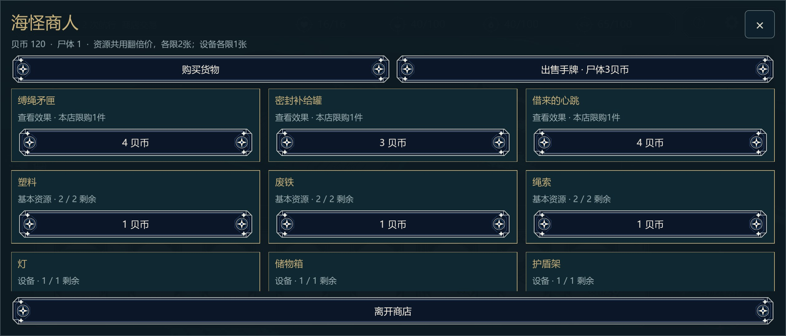

三列商品铺满全屏，但**第三排（灯 / 储物箱 / 护盾架）只露出标题，购买按钮被固定的「离开商店」条压住**：库存滚动区可视 434、内容 507，溢出 73。两个页签的装饰菱形在中间挤在一起。

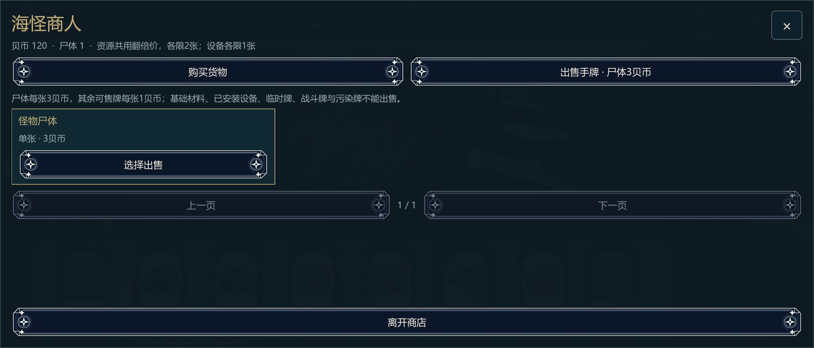

出售页只有 3 张卡就结束，中下部约 2/3 是空板；卡片字号明显小于购买页。

### 战斗

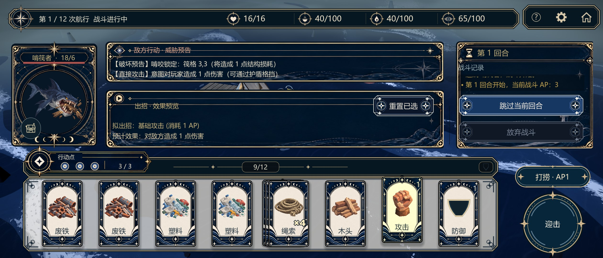

中部两块面板（威胁预告 / 出招预览）背景色 `Color(0.015,0.03,0.045,0.35)`（`pages/battle_hud_view.gd:447`），背后木筏与浪花直接透上来，正文对比度偏低；右栏「战斗记录」窄且只有一行，浪费了 21:9 的宽度。「重置已选」压在面板右上边框线上。

### 工具台

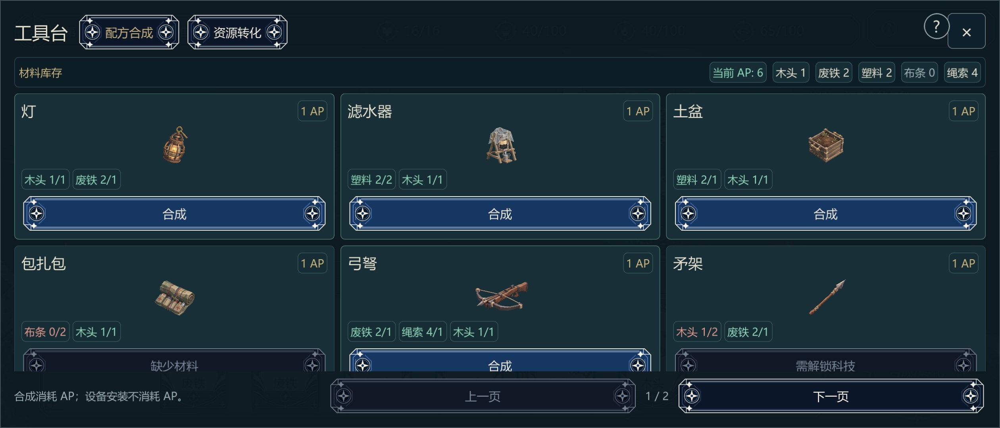

3 列 × 2 行配方铺满，但**第二排的「合成 / 缺少材料」按钮被「上一页 1/2 下一页」切掉一半**：配方滚动区可视 467、内容 502，溢出 35。

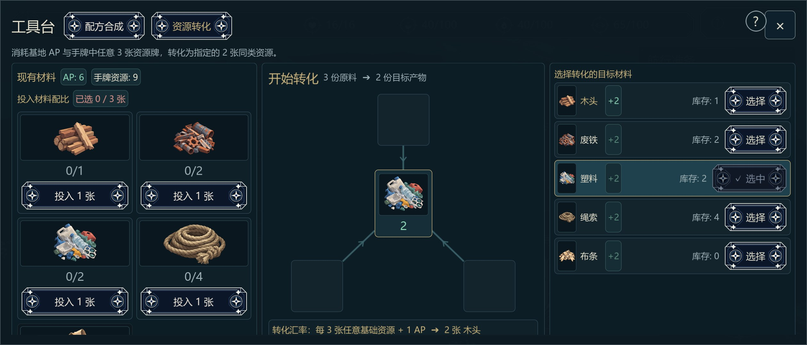

三栏并排在 21:9 下舒展，但左栏只能看到 4 个材料，第 5、6 个完全不可见：整页滚动区可视 567、内容 769，溢出 202。中间转化流程图在未选料时是几个空框，容易被读成加载失败。

### 遗物仓库 / 图鉴

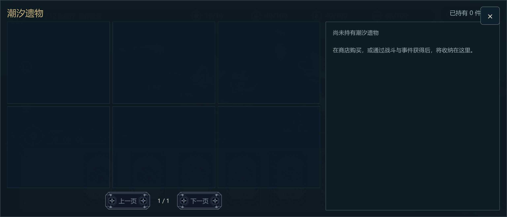

空持有时左侧 6 个空格 + 右侧空详情，信息密度偏低，但结构清晰。

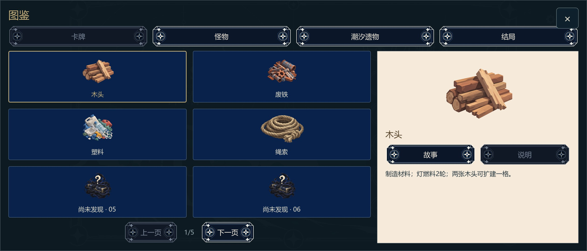

21:9 下仍是 2 列卡（1/5 页），右侧详情是整块浅米色，与深色主题反差很大；四个页签的菱形装饰同样拥挤。图鉴只能在首页打开，局内打开会得到「当前阶段没有这个入口」提示。

### 设置

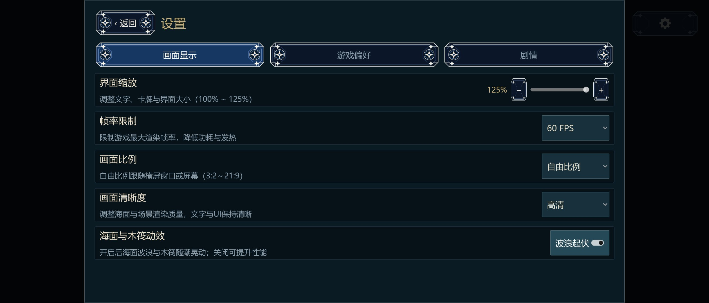

按设计取安全区内最大 16:9 矩形（1920×1080）居中，21:9 下左右各留 300 px 遮罩，**只有 76% 宽度可用**，而设置只是单列开关+下拉，完全可以用满宽度。

## 客观测量：滚动区可视高度 / 内容高度

用探针遍历各页 `ScrollContainer`，比较 `size.y` 与 `v_scroll_bar.max_value - page`（逻辑像素）：

| 界面 | 滚动区 | 可视高 | 内容高 | 溢出 | 后果 |
|---|---|---|---|---|---|
| 事件·选项 | `NodeEventChoicesScroll` | 236 | 286 | 50 | 4 项节点时第 4 项不可见 |
| 商店·买入 | `MobileShopStockScroll` | 434 | 507 | 73 | 第三排购买按钮被底栏压住 |
| 工具台·配方 | `MobileRecipeScroll` | 467 | 502 | 35 | 第二排按钮被分页条切半 |
| 工具台·转化 | `MobileTransmutePageScroll` | 567 | 769 | 202 | 左栏第 5、6 个材料不可见 |
| 设置 / 遗物仓库 | — | — | — | 0 | 内容未溢出 |

四处的共同点：**内容确实可以滚动，但界面上没有任何滚动提示**（无滚动条、无渐隐、无「还有 N 项」），玩家只会以为内容就这么多。

## 优化建议

### P0 内容被裁（建议优先处理）

1. **事件选项**：在选项栏底部加「还有 N 项 · 上滑」提示或 4 px 细滚动条；或让选项按钮高度按可用高度自适应（当前每项 64，4 项需 286 > 236，压到 52～56 即可一屏放下，仍 ≥44 触控下限）。位置：`pages/flow_story.gd`。
2. **商店库存**：底部操作条与滚动区分离（footer 固定、滚动区让出高度），并按可用高度决定每排数量（21:9 短屏改为 3 列 × 3 排或加滚动提示）。位置：`pages/shop_page.gd`。
3. **配方合成**：把「上一页 1/2 下一页」放进固定 footer 并让滚动区扣掉它的高度；短屏每页 4 个（2×2）比 6 个更稳。位置：`pages/craft_page.gd`。
4. **资源转化**：左栏材料列表独立滚动（现在整页一起滚，右栏固定内容也跟着动），或材料卡改 3 列降低高度。位置：`pages/craft_page.gd`。

### P1 21:9 的横向浪费

5. **首页**：海报改 `COVER` 裁切，或把 `nautical_frame` 这类程序化木框按视口比例拉伸，消掉左右 300 px 黑边。
6. **设置**：宽屏时不锁 16:9，按 `min(视口, 2.2:1)` 放宽，单列设置铺满即 100% 可用宽度。位置：`application/page_host.gd` 的 inset 计算。
7. **新局准备**：手机改成两栏（左难度+说明、右出身/种子/起手），关闭按钮提到 60×60 触控区。位置：`pages/new_game_setup.gd`。

### P2 可读性与视觉

8. **战斗面板对比度**：`lp_style.bg_color` 的 alpha 0.35 → 手机 0.75 左右；右栏战斗记录可加宽或并入中部。
9. **手牌托盘**：牌少时浅灰空板占比过高，建议托盘宽度随手牌自适应，或换成更暗的木质底并加纹理。
10. **图鉴**：21:9 下可 3 列；右侧详情从浅米色改为与其它面板一致的深色；页签菱形装饰在窄间隙下会互相挤压，可去掉中间两颗。
11. **提示条**：`当前阶段没有这个入口` 这类 toast 贴在屏幕最左侧、小字无底衬，建议居中 + 半透明底板 + 自动淡出。

## 未覆盖与遗留

- 仅桌面 GPU 渲染模拟，未在 Android 真机验证安全区、刘海与系统返回键；`21:9` 只是一个代表点，20:9 / 19.5:9 未逐一截图，但逻辑高度同为 720，纵向结论一致。
- 未验证结算页与剧情模式专属界面（本轮未进入终局）。
- 本轮只出报告，未修改任何布局代码；P0 四条与 P1 第 5～6 条改动量都不大，可另开一轮实施并补审计断言。
- 事件页截图已包含 2026-10-20 当天的两处改动（恢复手机插画栏、选项栏去掉顶部行并把「取消选择」放进选项内），与更早的 `mobile-ui-readability` 截图不同属预期。

## 后续处理（同日）

本报告的部分结论在同日晚些时候的界面整理中已修复，本文保留当次快照：

| 项 | 处理 |
|---|---|
| P0-1 事件选项第 4 项不可见 | 手机事件页底边下移到视口下沿并覆盖手牌区，三栏由 268 增至约 578，4 个选项一屏可见；桌面按用户要求保持原布局（底边 328） |
| P0-2 商店第三排被「离开商店」压住 | 删除底部离开按钮，离开改为右上角 X，第三排按钮完整可见 |
| P0-3 配方第二排被页码栏切半 | 取消翻页与页码栏，改为整列表滚动 |
| P0-4 转化左栏材料不可见 | 交互改为点图标加料、点槽位减料，并删掉顶部说明条与转化摘要后整页高度回落到一屏内；左栏仍在整页滚动内，未改为独立滚动 |
| P1-6 设置只有 76% 宽度可用 | 未处理 |
| P1-7 新局准备仍是桌面窄弹窗 | 未处理 |

实施与验证见 [局内界面整理](ingame-ui-pass-20261020.md)。
